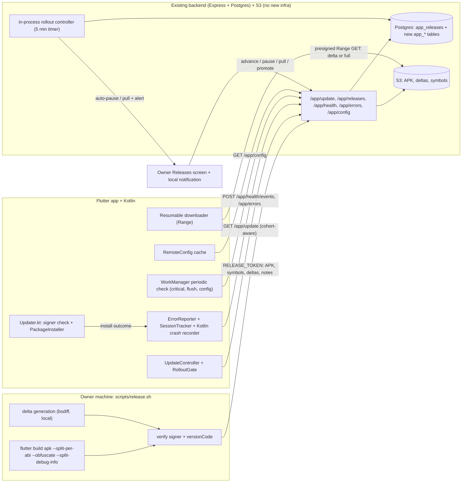

# Sparky OTA v2 - system design

Status: proposal (design only, nothing implemented). Date: 2026-10-14.
Scope: next generation of over-the-air updates for the sideloaded Android app `com.sparky.app`.

Evidence labels: **[code]** = read in this repo; **[src]** = fetched from the cited URL during this research; **[know]** = prior knowledge, not re-verified, and covered by a Phase 0 spike or an explicit "verify".

## 0. Owner decisions (fixed requirements)

1. **Crash reporting is built in-house** on the existing backend/telemetry pipeline, owner-only, on our server. No Sentry, GlitchTip or any third-party crash service.
2. **Shorebird: not now.** The design covers full-APK updates only and has no dependency on Shorebird. A short "future" note is in section 4.1.
3. **No FCM / Firebase.** Critical updates are found by a periodic background check (WorkManager).
4. Feature flags / remote config are self-built (no new containers). Release pipeline is a local one-command script (no CI holding the signing key).
5. **Zero new infrastructure on the server**: no new containers, processes, databases or SaaS accounts. Everything runs in the existing Express process, Postgres and S3 bucket.

---

## 1. Goals and non-goals

Goals
1. Ship APK updates safely: staged rollout, health-gated, automatic pause/pull, owner alerts.
2. See crashes/errors per version, readable (symbolicated), with no third party seeing user data.
3. Smaller, resumable, battery/network-aware downloads (delta updates, Range resume).
4. Remote config / kill switches without a release.
5. A one-command, reproducible, secret-safe local release script that turns the changelog into release notes.
6. Owner dashboard (Releases screen): rollout progress, adoption, health, channels.
7. Every phase independently shippable and reversible; server footprint stays small.

Non-goals
- Code push (Shorebird or DIY), Play Store, iOS, non-arm64 ABIs.
- Any new server component: Sentry (self-hosted or SaaS), GlitchTip, Unleash/GrowthBook/Flagsmith, ntfy, Redis, Mongo, CI runners.
- Replacing the PackageInstaller installer or its signing-cert check (they stay the root of trust).
- Native crash (tombstone/minidump) symbolication.

---

## 2. Current state (read from the code)

**Backend** (`backend/src/ota/logic.ts`, `service.ts`, `routes/app.ts`) [code]
- `app_releases`: `version, build (unique), kind (patch|feature|major|critical), title, notes json[<=6], apk_key, sha256, size, min_supported_build, status (draft|live|pulled), created_at, published_at`. `build` = pubspec N; installed versionCode = `2000 + N` (split-per-abi arm64); the app subtracts `abiOffset`.
- `app_installs`: one row per user: last `build`, `version`, `seen_at`, upserted fire-and-forget on every `GET /app/update?build=`. This is the only adoption data. No per-attempt install outcome, no sessions.
- `GET /app/update` (any signed-in user): loads all live rows, `decideUpdate` picks the highest live build newer than the client, escalates `kind` to the most severe live release in between, computes `required` (critical or below `min_supported_build`), returns a 1 h presigned S3 URL, `Cache-Control: private, max-age=300`. **Every live release is visible to every user immediately: no cohorts, no channels, no health.**
- Owner CRUD at `/app/releases` (`requireOwner`). Upload is buffered multipart (`multer.memoryStorage`, 150 MB cap), sha256 in memory, key `releases/<build>/sparky-<ver>-arm64.apk`. `releaseTokenRouter` lets `scripts/publish-apk.sh` POST with `RELEASE_TOKEN` (constant-time compare, acts as owner, create route only).
- Status changes are manual; nothing automatic ever changes status.

**Script** `scripts/publish-apk.sh` [code]: uploads an already-built APK; version/build from `pubspec.yaml`; token read from env or `backend/.env`, passed to curl through a stdin config (not argv). It does not build, sign, obfuscate or upload symbols; notes come from `--note` flags, not the changelog.

**Android build** [code]: `build.gradle.kts` signs `release` with `key.properties` when present, **else silently falls back to the debug key** (a foot-gun: a missing secret yields a debug-signed APK that the installer rejects as `signature_mismatch`). R8 minify + shrink on. `versionCode = flutter.versionCode`.

**Flutter app** `frontend/lib/core/update/*` [code]
- `UpdateController`: first check 3 s after start, re-check on resume if last check >6 h; manual check; phases idle/downloading/ready/needsPermission/installing/failed; failures network/verify/signature/install.
- `UpdatePolicy` (pure): none/dot/sheet/blocking; critical or `required` = blocking; patch = dot (+ auto-download on Wi-Fi); feature/major = sheet once, then +3 d, +7 d, then dot; one local notification per version.
- `UpdateDownloader`: single `GET` of the presigned URL to `cache/updates/*.apk.part`, streaming sha256, 30 s stall timeout, rename on match, deletes the partial on **any** error. **No resume.**
- `Updater.kt` (`sparky/updater`): `canInstall`, `openInstallSettings`, `install(path)`: package-name + signing-cert equality, then a `PackageInstaller` MODE_FULL_INSTALL session (`USER_ACTION_NOT_REQUIRED` on API 31+); `UpdaterReceiver` reports success/cancelled/failed. **Outcomes are never reported to the server.**
- Owner screen `releases_screen.dart` + `releases_controller.dart` + `release_form_sheet.dart`: list, edit, go live/pull, upload, per-build adoption counts.

**Telemetry** [code]: `routes/telemetry.ts`, `telemetry/queries.ts`, `usage_events` are **LLM-call telemetry** (model, provider, latency, tokens, ok/error), owner-only. There is no client telemetry and **no crash/error reporting in the app** (no `FlutterError.onError`, `runZonedGuarded`, Sentry, Firebase or WorkManager anywhere in `frontend/`). The manifest already has `FOREGROUND_SERVICE`, `FOREGROUND_SERVICE_DATA_SYNC`, `POST_NOTIFICATIONS`, `RECEIVE_BOOT_COMPLETED`, `REQUEST_INSTALL_PACKAGES`. No `google-services.json`; Google sign-in uses Credential Manager only. The server already has `util/rateLimit.ts`, `nlp/pii.ts` (redactor), `lifecycle.ts` (in-process timers).

Consequences: health data does not exist, so it must be created before any automation is trusted; rollout is all-or-nothing; downloads are non-resumable.

---

## 3. Architecture



### Data flow: release -> rollout -> install -> health -> rollback
1. **Release.** `scripts/release.sh` builds (obfuscated, split debug info), signs, verifies signer and versionCode, computes sha256 and deltas locally, uploads APK + symbols + deltas, calls `POST /app/releases` with channel, rollout plan and notes from the changelog. Status `draft`.
2. **Rollout.** Owner (or `--live`) sets `live` with `rollout_bp = 500` on channel `stable`. `GET /app/update` filters by cohort: `bucket = uint32(sha256(userId + ":" + releaseId)[0..4]) mod 10000 < rollout_bp`. Others keep seeing the previous release.
3. **Install.** App downloads (delta if offered, else full, resumable), verifies sha256, `Updater.kt` checks signer, installs. At each stage the app queues an install event and flushes it on the next network call.
4. **Health.** The new version sends session start/end and error groups. The controller computes per-release metrics vs the previous stable release over a sliding window with minimum sample sizes.
5. **Decision.** Healthy for the dwell time -> advance (or "ready to advance" for the owner to tap). Unhealthy -> auto-**pause** (freeze cohort), alert owner; severe -> auto-**pull** (`status=pulled`).
6. **Recovery.** Android cannot downgrade through PackageInstaller [know], so "rollback" means pull + ship a higher build (`release.sh --rebuild-from <tag>` re-releases the previous source as build N+1); `min_supported_build` can force the move.

---

## 4. Component decisions

### 4.1 Code push (Shorebird): deferred
Decision (owner): not now; no dependency in this design. All fixes ship as full APKs; deltas (4.4) and resumable downloads (4.5) make that cheap (a Dart-only change targets a ~1-5 MB download and one tap).

Future note, kept short so nothing in this design blocks it later:
- Shorebird patches Dart code only (not native code, assets by default, or Flutter upgrades); applied on the next process start; Android supported; rollback via `shorebird patches rollback` (CLI >= 1.6.120, Flutter >= 3.27.4); Free tier 5,000 patch installs/month, Pro $20/mo; **no self-hosting**; it sends app id, release version, patch number, arch, platform and an anonymous per-install `client_id` [src: https://docs.shorebird.dev/code-push/faq/, https://docs.shorebird.dev/code-push/rollback/, https://shorebird.dev/pricing/].
- Compatibility hooks already in the design: health events and sessions carry a nullable `patch_number`; `app_releases` can later gain `shorebird_release`; the release script is the single build entry, so swapping `flutter build` for `shorebird release android` is a one-line change. Open items for any future spike: how Shorebird's release version (derived from `versionName` [src]) maps to our `versionCode = 2000+N` split-per-abi scheme, and that the uploaded APK must be the Shorebird-built artifact.
- Alternatives (server-driven UI, DIY JIT) were considered and rejected for general code push; revisit only with the owner's approval of a new third party.

### 4.2 Crash and error reporting: build our own (owner decision)
Why not the alternatives (for the record): self-hosted Sentry's documented minimum is 4 cores, 16 GB RAM + 16 GB swap, 20 GB disk [src: https://develop.sentry.dev/self-hosted/], far beyond the shared server; GlitchTip is light (256-512 MB RAM, Postgres) [src: https://glitchtip.com/documentation/install] but is still a new service; Sentry SaaS free tier is 5k errors/mo [src: https://sentry.io/pricing/] but ships stack traces to a third party. Owner chose in-house.

Client capture (new `frontend/lib/core/errors/*`, plus Kotlin)
- Dart: `FlutterError.onError` (framework), `PlatformDispatcher.instance.onError` (async/platform errors; return `true`), `Isolate.current.addErrorListener` for the main isolate and an error port for each spawned isolate, `runZonedGuarded` only around pre-binding init.
- Kotlin: `Thread.setDefaultUncaughtExceptionHandler` in the `Application`/`MainActivity` writes throwable summary + thread name to a small file synchronously, then chains to the previous handler; uploaded at next launch (a dying process cannot do network).
- ANR / native-crash *signals* without NDK: at launch read `ActivityManager.getHistoricalProcessExitReasons` (`ApplicationExitInfo`, API 30+) for the previous process: `REASON_CRASH`, `REASON_CRASH_NATIVE`, `REASON_ANR`, `REASON_LOW_MEMORY`, `REASON_SIGNALED` [know]. Gives exit reason (and for ANR a trace stream) with no symbolication; native tombstone symbolication stays out of scope.
- Breadcrumbs: ring buffer of 30 (route changes, update phases, connectivity, memory-pressure callbacks, tagged log lines). **Never** message/chat content, prompts, file names, URLs with ids, request bodies.
- Sessions: per-process random `session_id`; `session_start` on cold start; `session_end(ok)` on clean pause/detach. A start without an end plus `ApplicationExitInfo` crash/ANR on the next launch = crashed session. Crash-free sessions per build = 1 - crashed/total.
- Client rate limits: max 10 distinct errors per session, same error at most once per 60 s, offline queue <= 50 entries / 200 KB, entries dropped after 7 days.

Server
- `POST /app/errors` (signed-in, rate-limited via `util/rateLimit.ts`, `user_id` from the session never the body); message and stack truncated (200 chars / 8 KB) and passed through `nlp/pii.ts`.
- Fingerprint = `sha1(type + top 3 app frames normalized)`: strip addresses/line numbers, keep `package:sparky/...` frames, ignore `dart:async`/framework frames beyond the first. Groups: `app_error_groups` with counts, approx distinct users, first/last build, status open|resolved|ignored; keep at most 5 sample events per group per build.
- Owner access only: `GET /admin/errors*` behind `requireOwner`, surfaced in the owner Releases/Errors screen (UI gate `isOwner()`).

Symbolication of obfuscated traces
- Build with `--obfuscate --split-debug-info=build/symbols/<build>` [know: Flutter docs "Obfuscating Dart code"]; `release.sh` uploads `app.android-arm64.symbols` and R8 `mapping.txt` to private S3 `symbols/<build>/` and records keys on the release.
- Raw obfuscated traces are stored as sent. Symbolication runs **on the owner machine** (`scripts/symbolize.sh <groupId>` downloads trace + symbols, runs `flutter symbolize -d <symbols> -i trace`, and `retrace` for Kotlin), so the server needs no Dart SDK. The dashboard shows obfuscated top frames and the build id.

Privacy / PII
- Whitelist fields only: type, truncated message, frames, build, device model, SDK int, ABI, locale, foreground/background, free-memory bucket, connectivity type, breadcrumbs.
- No IP stored in new tables; `user_id` stored (needed for distinct-user math), owner UI shows the id prefix and resolves to email only on explicit click (the telemetry events pattern).
- Settings switch "Send crash reports" (default on for owner, opt-out for others); turning it off stops sends and clears the queue. Retention: error events 30 d, sessions 90 d; group counts kept.

### 4.3 Staged rollout and automatic rollback
Deterministic cohorting
- `bucket = uint32(first 4 bytes of sha256(userId + ":" + releaseId)) mod 10000`; in cohort when `bucket < rollout_bp`. Stable and monotone as the percent grows; different per release so canaries rotate. Pure function in `ota/logic.ts` with fixed test vectors shared with Dart.
- Forced inclusion: `app_release_overrides(release_id, user_id, force)`; owner devices and beta members (4.9) always included.
- `/app/update` is `max-age=300`, and the app checks every 6 h, so widening propagates in minutes to hours; critical releases are also reached by the background check (4.7).

Default plan (editable per release)
| Step | Cohort | Min dwell | Advance when |
|---|---|---|---|
| 1 | owner + beta | 0 | manual |
| 2 | 5% | 12 h | health OK and sample floor met |
| 3 | 25% | 24 h | same |
| 4 | 50% | 24 h | same |
| 5 | 100% | - | - |
With a small user base 5% may be zero people, so effective cohort = max(percent, `min_cohort_users`). `critical` may skip to 100%. **Auto-advance defaults off** (steps become "ready to advance" for the owner), auto-pause/pull default on.

Health signals (per release `build`)
1. Crash-free sessions.
2. Install success = `install_ok` / (`install_ok` + `install_fail` + `verify_fail`); `cancelled` excluded; `signature_mismatch` is a separate hard-stop.
3. First-launch success: `first_launch_ok` within 60 s of install; crash loop = 2+ crashed sessions from one device in 10 minutes.
4. New error fingerprints per 100 sessions.
5. 5xx rate for requests carrying `x-app-build` vs previous build.

Thresholds vs the previous stable build over a trailing 24 h window (defaults in code constants, overridable in `rollout_policy` JSON):
| Signal | Min sample | Pause when | Pull when |
|---|---|---|---|
| crash-free sessions | >= 30 sessions, >= 5 users | < 98.5% and >= 2 points below previous (Wilson lower bound) | < 95%, or crash loop on >= 2 devices |
| install success | >= 5 attempts | < 85% | < 60% |
| first-launch success | >= 5 installs | < 90% | < 70% |
| new fingerprints/100 sessions | >= 50 sessions | > 3x previous and >= 3 users in one group | one new group in >= 20% of sessions |
| signature mismatch | 1 | - | pull immediately |
Below the minimum sample the state is "insufficient data": the release stays put and the dashboard says so. It never advances or pulls on silence from tiny cohorts. Also a "silent" alert if installed users send no `first_launch_ok` after N hours (health reporting itself may be broken).

Controller
- `setInterval` every 5 min in the backend (same pattern as `lifecycle.ts`; no cron container), guarded by `pg_advisory_lock`, evaluates live non-complete releases. States on `app_releases.rollout_state`: `staged -> paused -> staged|pulled`, `staged -> complete`. Each transition appends an `app_release_events` row with the metrics snapshot. At most one automatic action per release per hour.
- Pause freezes `rollout_bp`. Pull sets `status=pulled`. Already-installed devices are not downgraded (see data flow step 6).
- Alerts: owner-targeted local notification on the owner's device (delivered by the background check in 4.7 and on next launch) with release, signal, value vs threshold, sample size, action. Email only if a transactional mail path already exists [verify in code before Phase 3].
- Manual override (Releases screen): Pause/Resume, set percent (snapped to plan steps), Advance, Pull, Promote to stable, force-include a user, "Disable automation"; every manual change is audited and turns auto-advance off until re-enabled.

### 4.4 Delta updates
Why naive bsdiff on an APK is weak: an APK is a zip of individually deflate-compressed entries; one changed byte in `libapp.so` re-randomizes deflate output from that point on, so compressed old/new share almost nothing and a binary diff approaches the size of the new file (archive-patcher's own words: "probably about the same size of one of the zip files") [src: https://github.com/google/archive-patcher]. APK v2/v3 signing blocks also change each build.

| Approach | Notes |
|---|---|
| bsdiff/bspatch on whole APK | trivial, worst savings; bspatch needs old+new in memory [src: https://github.com/mendsley/bsdiff] |
| Google archive-patcher (file-by-file: uncompress changed entries, bsdiff, recompress with recorded deflate params) | right idea, Java, Android API 15+, but **repo archived 2024-06-24, unmaintained**, no zip64 [src] |
| zstd `--patch-from` | single binary on the build machine; needs a zstd lib on device (~1 MB arm64) [know]; same compressed-APK weakness unless per entry |
| **Own per-entry delta (recommended)** | see below |

Recommended format (v1)
- Modern AGP packs native libs STORED when `extractNativeLibs=false` (minSdk >= 23) [know: confirm with `unzip -v` in Phase 0]. For STORED entries (`libapp.so`, `libflutter.so`) the entry bytes are the file bytes, so a bsdiff of the entry old->new works without reproducing deflate. Small DEFLATED entries that changed (dex, assets) are shipped whole.
- Delta = header JSON `{old_sha256, new_sha256, entries[]}`; per new-APK entry in order: `copy_same(old_idx)`, `patch(old_idx, bsdiff)` or `literal(raw)`; trailer = new APK's EOCD, central directory and v2/v3 signing block verbatim. Reconstruction is bytewise, with no recompression.
- On device (Kotlin): check sha256 of the installed base APK (`applicationInfo.sourceDir`) equals `old_sha256` (else no delta), stream-apply into `.part`, verify sha256 == release sha256, then the usual `checkSigner` and install. Any failure -> delete and full download, report `delta_fail`.
- Generation is **local in `release.sh`** (not on the server): bsdiff memory is large (order of 10x file size [know]), so building deltas against the last 3 live APKs on the owner's machine and uploading them avoids any server CPU/RAM. The server only stores them (`app_release_deltas`) and advertises one whose `from_build` equals the client's build; skip a delta if > 60% of the full size.
- Libraries: Kotlin/JVM pure-Java bsdiff (e.g. `io.sigpwny:jbsdiff` / `bsdiff-java`) + `commons-compress` for zip, or `zstd-jni`; license-check and pick in Phase 0 [know]. Build side: `bsdiff` binary or a small script.
- Expected savings: a Dart-only change mostly touches `libapp.so` (~25-30 MB of the 39 MB [know]); typical AOT patch 1-5 MB [know]. Measure on three real release pairs; drop deltas if savings are < 40%.

### 4.5 Resumable, robust downloads
| | DownloadManager | WorkManager + Range (Kotlin) | Dart Range in `UpdateDownloader` | UIDT job (API 34+) |
|---|---|---|---|---|
| Survives process death | yes | yes | no | yes |
| Constraints (unmetered, battery not low, storage) | limited | full | manual | full [src: https://developer.android.com/develop/background-work/background-tasks/uidt] |
| Refresh expiring presigned URL | no | yes | yes | yes |
| Hash/progress into Dart | poor | good | best | good |

Rules [src: https://developer.android.com/develop/background-work/services/fgs/timeout, uidt page]: with targetSdk 35 a `dataSync` foreground service is capped at 6 h per 24 h in the background and must implement `onTimeout()`; starting one from the background throws `ForegroundServiceStartNotAllowedException`. UIDT jobs need `RUN_USER_INITIATED_JOBS`, a `JobService` with `setNotification`, can only be scheduled while the app is visible, are exempt from standby-bucket quotas, have no Jetpack wrapper, and on Android 13 and lower the docs say to use WorkManager's foreground service instead.

Recommendation
1. Phase 1 (pure Dart): make `UpdateDownloader` resumable. Keep `.part`; send `Range: bytes=<len>-` with `If-Range: <ETag>`; require 206 + matching `Content-Range`; on 416 or ETag change restart; re-hash the existing prefix on resume; request a fresh presigned URL when the stored one is > 50 min old or on 403; backoff 2/4/8/16/32 s on network errors; **do not delete the partial on network errors** (today it does); persist build/etag/bytes in prefs.
2. Phase 6: WorkManager for background downloads of small/optional updates (UNMETERED + battery-not-low, no foreground service needed for a few MB) and optionally a UIDT job on API 34+ for user-tapped downloads. Skip DownloadManager (cannot refresh URLs, poor hashing/constraint control).

### 4.6 Remote config / feature flags: self-built
| Option | Verdict |
|---|---|
| **Self-built table + cached endpoint** | chosen: no new process, percent + overrides via the same cohort hash |
| Firebase Remote Config | needs Firebase project/`google-services.json`; excluded by decision 3 |
| GrowthBook / Unleash / Flagsmith self-hosted | extra service(s) and DB (Mongo for GrowthBook); excluded by decision 5 [know: sizing not verified] |

Design
- `app_flags(key pk, type, default_value jsonb, rollout_bp null, min_build null, max_build null, channel null, enabled, description, updated_at)` and `app_flag_overrides(key, user_id, value)`.
- `GET /app/config?build=N` (signed-in): resolved map `{flag: value}` (override > rule > default), `etag`, `ttl`; honors `If-None-Match` (304); < 1 KB; 30 s in-memory server cache. Client caches in `shared_preferences`; refreshes on cold start, resume after > 1 h, and from the background worker; compile-time defaults when offline.
- Uses: kill switches, `ota.check_interval_hours`, `ota.delta_enabled`, `errors.sample_rate`, rollout tuning, UI copy toggles.
- Owner UI: "Flags" section with toggles and percent sliders; audit via `app_release_events`-style `app_flag_events`.

### 4.7 Critical updates: periodic background check (owner decision, no FCM)
| | Verdict |
|---|---|
| FCM | rejected (decision 3): Firebase project, `google-services.json`, Google SDK/installation id, nothing on devices without GMS |
| UnifiedPush/ntfy | rejected: extra server + distributor app on every device |
| **WorkManager periodic check** | chosen |
| Status quo (cold start + resume > 6 h) | insufficient: an idle app never learns of a critical fix |

Design
- `UpdateWorker` (Kotlin, `androidx.work:work-runtime-ktx`): `PeriodicWorkRequest`, default 12 h (flag-tunable via `ota.check_interval_hours`; platform minimum is 15 min and execution is deferred by Doze/standby [know]), constraints `NetworkType.CONNECTED`, flex window, unique work name, `ExistingPeriodicWorkPolicy.KEEP`, re-enqueued after boot (`RECEIVE_BOOT_COMPLETED` already declared; WorkManager persists anyway).
- The worker calls `GET /app/update`, `GET /app/config`, flushes queued health/error events, and for `critical`/`required` (or an owner alert) posts a local notification through the existing notification channel (same dedupe as `shouldNotify`). It never downloads critical APKs unattended: the tap opens the app's blocking screen; small optional patches may download on UNMETERED + battery-not-low.
- Auth: the worker needs the session token. Spike two ways and pick one: the `workmanager` Flutter plugin running a Dart callback (reuses the Dart HTTP/auth code, ~one Flutter engine spin-up per run), or a Kotlin worker reading a token copy kept in `EncryptedSharedPreferences`. Prefer the plugin for speed of delivery unless engine start cost is a problem on the owner's device.
- Latency expectation: hours (≤ interval + Doze delay); a force-stopped app never runs. Accepted for this app.

### 4.8 Release pipeline: local one-command script (owner decision)
| Option | Verdict |
|---|---|
| **Local script** | chosen: keystore never leaves the owner machine; extends today's model |
| GitHub Actions / Codemagic | rejected (decision 4): keystore + RELEASE_TOKEN would sit in a CI secret store (fork/PR-workflow and log-echo leak surface); reproducibility gain not needed for one owner. Mitigate drift by pinning the Flutter version in the script (`flutter --version` check against a committed `.flutter-version`). |

`scripts/release.sh` (publish-apk.sh stays as the low-level uploader)
1. Preconditions: clean git tree on `main`; `key.properties` exists; `flutter analyze`, tests, `pnpm typecheck` pass; Flutter version matches the pin.
2. Version: reads `pubspec.yaml`; refuses unless `build` > server's highest (token-readable `GET /app/releases`).
3. Build: `flutter build apk --release --split-per-abi --target-platform android-arm64 --obfuscate --split-debug-info=build/symbols/<build>`. Gradle gets a hard error when the release task would sign with the debug key (e.g. `-Prelease=true` makes the fallback fail).
4. Verify: `apksigner verify --print-certs` SHA-256 equals pinned `OTA_SIGNER_SHA256` (public, committed in `scripts/.release-signer`); `aapt2 dump badging` shows package `com.sparky.app` and versionCode `2000 + build`.
5. Notes: the changelog entry for this version (`frontend/lib/core/constants/changelog.dart`, which holds the About "What's new") is parsed into <= 6 notes of <= 300 chars (the server limits) plus a title; `--note` overrides.
6. Deltas: bsdiff against the last 3 live APKs (downloaded via presigned URLs from the token-readable release list), skipped where > 60% of full size.
7. Upload: APK (multipart as today), then symbols, mapping and deltas via new token routes. `draft` unless `--live`; `--live` implies `channel=stable`, `rollout_bp=500` unless `--rollout`.
8. Prints sha256, size, Releases screen hint. `--rebuild-from <tag>` re-releases earlier source as a new higher build (the practical "rollback").
Secrets: `RELEASE_TOKEN` read from env/`.env`, passed via curl stdin config (kept); token routes use an allow-list (create release, upload symbols/deltas, read releases, limited PATCH of `status|channel|rolloutBp`) and nothing else; rotate by changing the env var. **Keystore backup: two offline encrypted copies**: losing the key permanently ends OTA for installed copies (the signer check blocks any other key); add to the runbook.

### 4.9 Beta channel and owner dashboard
Channels
- `app_releases.channel` (`stable`|`beta`); `app_installs.channel` default `stable`. Beta users get the highest release across `beta` and `stable`; stable users only `stable`. Promotion flips `channel` on the same release (same APK, same build): no rebuild.
- Membership: owner-approved list (small base; owner decision list item 6), "Join beta" request in Settings -> About.

Dashboard (extends `releases_screen.dart` / `releases_controller.dart`; strings and sizes in constants per repo rules)
- Release card: status, channel, rollout bar with step ladder, state (staged/paused/complete/pulled) with reason, buttons Pause / Resume / Advance / Pull / Promote.
- Health tiles per release vs previous with sample sizes and an "insufficient data" state; hourly crash-free-session sparkline for 7 days.
- Adoption: per-build counts from `app_installs` plus a daily rollup `app_install_history`; users not on latest with last-seen.
- Errors list by users affected for the selected build, copyable `symbolize.sh <id>` command, resolve/ignore.
- Timeline from `app_release_events` (actor, action, metrics snapshot). Flags section (4.6).
All new endpoints `requireOwner`.

---

## 5. Data model changes
Hand-written migrations in `backend/prisma/migrations/<ts>_<name>/migration.sql`, additive only; never run against shared DBs.

```
-- app_releases (additive)
channel text not null default 'stable'            -- stable | beta
rollout_bp int not null default 10000             -- 0..10000
rollout_state text not null default 'staged'      -- staged | paused | complete | pulled
rollout_plan jsonb not null default '[]'          -- [{bp,minDwellH}]
rollout_policy jsonb null                         -- threshold overrides
auto_advance boolean not null default false
signer_sha256 text null
symbols_key text null; mapping_key text null
pulled_reason text null; pulled_at timestamptz null

-- new tables
app_release_deltas(id uuid pk, release_id fk, from_build int, key text, size bigint, sha256 text, created_at, unique(release_id, from_build))
app_release_events(id bigserial pk, release_id fk, at timestamptz, actor text /* owner:<id>|auto|script */, action text, detail jsonb)
app_install_events(id bigserial pk, user_id fk, device_id text, at, build int, to_build int, patch_number int null, stage text, ok bool, code text null, bytes bigint null, via text /* full|delta|resume */)
app_sessions(id uuid pk /* client session id */, user_id fk, build int, patch_number int null, started_at, ended_at null, outcome text /* ok|crash|anr|killed|unknown */)
app_error_groups(fingerprint text pk, first_build int, last_build int, count bigint, users int, first_seen, last_seen, status text, title text)
app_error_events(id bigserial pk, fingerprint fk, user_id fk, build int, at, kind text /* dart|platform|isolate|kotlin|anr|native_signal */, message text, stack text, breadcrumbs jsonb, device jsonb)
app_flags, app_flag_overrides (4.6), app_flag_events
app_install_history(day date, build int, channel text, users int)
-- app_installs (additive): channel text default 'stable', device_id text null, patch_number int null
```
Indexes: `app_sessions(build, started_at)`, `app_install_events(to_build, at)`, `app_error_events(fingerprint, at)`. Retention via the in-process daily sweeper: sessions/install events 90 d, error events 30 d, rollups forever. `patch_number` is nullable and unused until a future code-push decision.

---

## 6. API endpoints
User-facing (signed-in, existing auth stack)
- `GET /app/update?build=N&channel=&device=`: cohort-aware; adds `rollout:{eligible}`, `delta:{fromBuild,url,size,sha256}|null`; `Cache-Control: private, max-age=300` kept.
- `POST /app/update/refresh-url` (or re-call `/app/update`): fresh presigned URL for resume.
- `POST /app/health/events` (batch <= 50), `POST /app/errors` (batch <= 10): rate-limited, user from session.
- `GET /app/config?build=N` (ETag/304).

Owner (`requireOwner`)
- Existing `GET/POST/PATCH/DELETE /app/releases`; PATCH gains `channel, rolloutBp, rolloutState, autoAdvance, rolloutPlan, rolloutPolicy`.
- `POST /app/releases/:id/{advance,pause,resume,pull,promote}`; `GET /app/releases/:id/{health,events}`.
- `GET /admin/errors`, `GET /admin/errors/:fingerprint`, `PATCH` status; `GET/PUT /admin/flags`.
- `POST /app/releases/:id/symbols`, `POST /app/releases/:id/deltas` (also token-allowed).

---

## 7. App-side modules
Dart (`frontend/lib/core/`)
- `update/`: `rollout_gate.dart`, `update_downloader.dart` (Range, backoff, URL refresh), `delta_applier.dart` (channel to Kotlin), `update_events.dart` (queue install outcomes), `update_policy.dart` (+ beta awareness; semantics unchanged).
- `errors/`: `error_reporter.dart`, `breadcrumbs.dart`, `session_tracker.dart`, `error_settings.dart`.
- `config/remote_config.dart`.
- `features/update/`: extended Releases screen; owner-only `errors_screen.dart` (`isOwner()` gate).
- Copy, icons, sizes, thresholds' display strings in `constants/` (`update.dart`, new `errors.dart`, `remote_config.dart`); no magic numbers in widgets.

Kotlin (`frontend/android/app/src/main/kotlin/com/sparky/app/`)
- `Updater.kt`: add `applyDelta(basePath, deltaPath, outPath)`, `baseApkSha256()`, archive versionCode check; `checkSigner` stays mandatory before every install, including reconstructed APKs.
- `CrashRecorder.kt` (uncaught handler -> file), `ExitInfoReader.kt` (channel `sparky/diagnostics`, `lastExitReason()`).
- `UpdateWorker.kt` or the `workmanager` plugin callback (4.7); later `DownloadJobService.kt` (UIDT, API 34+) with manifest `RUN_USER_INITIATED_JOBS` and a `BIND_JOB_SERVICE` service.

---

## 8. Security
- **Root of trust: the signing certificate.** Android refuses a different-cert update, and `Updater.checkSigner` pre-checks. Every path (delta-reconstructed, resumed) ends in sha256 + signer check. `OTA_SIGNER_SHA256` pin in `release.sh` catches a debug-signed build before upload.
- **Integrity chain:** server stores sha256 of the uploaded APK; deltas carry `old_sha256`/`new_sha256`; mismatch -> full download -> fail closed. TLS; presigned URLs time-boxed (1 h).
- **Downgrade:** server never offers a lower build; app refuses `latest.build <= current` (already). New: `Updater.kt` also checks the archive's `versionCode == 2000 + advertised build` and is greater than the installed code, so a compromised API cannot replay an old signed APK under a fake build number.
- **Tokens:** `RELEASE_TOKEN` constant-time compared (existing), never in argv (existing), route allow-list (new), use logged to `app_release_events` (actor `script`). Owner routes `requireOwner`. Ingest endpoints take `user_id` only from the session.
- **PII:** whitelist payloads, server-side redaction, random per-install `device_id` (not ANDROID_ID, reset on sign-out/clear data), no IPs in new tables, retention windows, Settings opt-out. No third party receives any of it.
- **Secrets:** keystore and `key.properties` never in repo or CI; symbols and `mapping.txt` are private S3 objects (they de-obfuscate the app).

---

## 9. Failure modes and handling
| Failure | Handling |
|---|---|
| Download drops at 95% | Range resume with ETag guard; backoff; fresh URL on 403 |
| Presigned URL expires mid-download | refresh URL, continue from `.part` |
| Delta missing, > 60% of full, base APK differs, apply error, sha mismatch | no delta / full download; `delta_fail` event |
| Reconstructed or full APK wrongly signed | `signature_mismatch` -> hard-stop signal -> auto-pull |
| PackageInstaller failure/cancel; unknown-sources revoked | existing statuses/phases; reported; cancelled excluded from success rate |
| Tiny user base | "insufficient data"; no automatic advance or pull below minimum samples |
| One noisy device | thresholds count distinct users; crash-loop needs >= 2 devices to pull |
| Health reporting broken in a release | missing `first_launch_ok` raises a "silent" alert and pauses |
| Controller bug flaps state | audited transitions, 1 action/hour/release, "Disable automation" toggle |
| Pulled release already installed | no downgrade; ship higher build (`--rebuild-from`), `min_supported_build` to force |
| Postgres down | client keeps its 5-min cached check; ingest returns 503 and clients keep their queue |
| Error flood | per-session/per-fingerprint client caps; server cap 200 events/user/day; group counts still increment |
| Server restarts mid-upload | S3 put before DB insert (existing); sweeper removes orphan keys |
| Keystore lost | OTA ends for installs; offline encrypted backups (runbook) |
| Worker deferred / app force-stopped | accepted; cold-start/resume check remains |
| Clock skew | all windows use server timestamps |

---

## 10. Resource footprint on the server
- **No new containers, processes, databases or accounts.** Everything runs in the existing Express process, Postgres and S3.
- Postgres: narrow tables; at ~50 active users ~15 k session rows/month; tens of MB per year with retention.
- CPU/RAM: the controller is a few aggregate queries every 5 min; deltas are generated on the owner's machine so the server never runs bsdiff. Switch APK upload from `multer.memoryStorage` (up to 150 MB RSS) to streaming into S3 multipart while hashing (Phase 1), reducing peak memory.
- S3: +3 deltas (~1-5 MB) and symbols per release (sizes to be measured); sweeper keeps the last 5 releases' extras.
- Network: lower than today (deltas, resumed downloads).

---

## 11. Phased implementation plan
Each phase is independently shippable and has a revert switch (flag or script option).

**Phase 0 - Spikes (no product change).** `unzip -v` the arm64 APK (which entries are STORED); bsdiff/zstd between two real releases (e.g. 1.9.x -> 1.10.0); pick the Kotlin bsdiff library and license; workmanager-plugin vs Kotlin worker auth. Acceptance: numbers and decisions appended to this doc.

**Phase 1 - Health foundation + robust downloads.** `app_install_events`, `app_sessions`, `POST /app/health/events`, install outcomes from `UpdateController`, session tracker, `x-app-build` header, resumable downloader with URL refresh, archive versionCode check in `Updater.kt`, streaming upload. Acceptance: unit tests for resume (206/416/ETag change/URL refresh/backoff) and event validation + rate limit; manual: cut network at 60%, restore, completes with matching sha256; Releases screen shows install success rate for a test release; `flutter analyze` and `pnpm typecheck && pnpm test` clean.

**Phase 2 - In-house error reporting.** `ErrorReporter`, Kotlin crash recorder + `ApplicationExitInfo` reader, `app_error_*` tables, fingerprint/dedupe, `--obfuscate --split-debug-info` build + symbols upload, `symbolize.sh`, owner errors list, Settings toggle. Acceptance: forced Dart, async, isolate and Kotlin exceptions each appear as one group with counts incrementing; offline queue flushes; obfuscated trace symbolizes via script; payload fixtures contain no user content (PII test); non-owner gets 403; crash-free sessions per build visible.

**Phase 3 - Staged rollout + automation.** Cohort hash with shared test vectors, `rollout_*` columns, filtered `/app/update`, Releases screen controls, 5-min controller, thresholds + minimum samples, alerts, audit events. Acceptance: cohort is monotone in percent and uniform within 1% over 10k synthetic users; synthetic metrics: no action below minimum sample, pause on crash-free drop, pull on signature mismatch, max 1 auto action/hour; manual pause/advance audited; forced owner device always sees the release; end-to-end staged release on test devices.

**Phase 4 - Release script v2.** `scripts/release.sh`, Gradle hard-fail on debug signing for release, signer pin, changelog -> notes, symbols upload, token allow-list, runbook. Acceptance: dry run prints plan without uploading; debug-signed build refused; notes limits tested against the real changelog; token rejected on non-listed routes (backend test).

**Phase 5 - Remote config + beta channel.** `app_flags`, `/app/config`, client cache, owner Flags UI, channel columns, "Join beta", promotion. Acceptance: flag precedence tests; 304 handling; offline default; beta user sees beta build and stable user does not; promotion exposes the same APK to stable without rebuild.

**Phase 6 - Background heartbeat.** WorkManager periodic check -> critical local notification, event flush, config refresh; optional UIDT download job on API 34+. Acceptance: with the app swiped away, a critical release produces a notification within the interval on a test device; constraints respected; `adb shell cmd jobscheduler` stop/retry resumes a download.

**Phase 7 - Deltas.** Format v1, local generation in `release.sh`, `app_release_deltas`, Kotlin applier, fallback. Acceptance: three real release pairs reconstruct to the exact full-APK sha256; corrupted delta or wrong base -> automatic full download; savings >= 40% for a Dart-only change or the phase is dropped; signer check still runs.

(Future, only with a new owner decision: Shorebird, see 4.1.)

---

## 12. Sources
- Shorebird FAQ / rollback / pricing (future note only): https://docs.shorebird.dev/code-push/faq/ , https://docs.shorebird.dev/code-push/rollback/ , https://shorebird.dev/pricing/
- Sentry self-hosted requirements: https://develop.sentry.dev/self-hosted/ ; Sentry pricing: https://sentry.io/pricing/
- GlitchTip install/resources: https://glitchtip.com/documentation/install
- Google archive-patcher (archived 2024-06-24): https://github.com/google/archive-patcher
- bsdiff (mendsley): https://github.com/mendsley/bsdiff
- Android UIDT jobs: https://developer.android.com/develop/background-work/background-tasks/uidt
- Android FGS timeouts (dataSync 6 h/24 h): https://developer.android.com/develop/background-work/services/fgs/timeout
- WorkManager define work: https://developer.android.com/develop/background-work/background-tasks/persistent/getting-started/define-work
Items tagged [know] were not re-verified here and are covered by Phase 0 or explicit "verify" notes. Not reachable during research: Unleash docs (sizing not verified), FCM options page (404).

---

## 13. Open decisions for the owner
Already decided (section 0): own crash reporting, no Shorebird now, no FCM, self-built flags, local release script, zero new infrastructure.
Still open, with recommendations:
1. **Auto-advance policy.** Recommend auto-pause/pull on, auto-advance off for the first three releases, then per release.
2. **Alert channel.** Recommend local notification now; email only if a mail path already exists.
3. **Beta membership.** Recommend owner-approved list.
4. **Retention** (errors 30 d, sessions 90 d). Recommend as specified.
5. **Keystore backup** locations (two offline encrypted copies). Blocks Phase 4 sign-off.
6. **Worker auth approach** (workmanager plugin vs Kotlin worker). Recommend plugin, decide after Phase 0 spike.
7. **UIDT download job** (needs API 34 / targetSdk 35 considerations). Recommend optional enhancement after WorkManager baseline.
